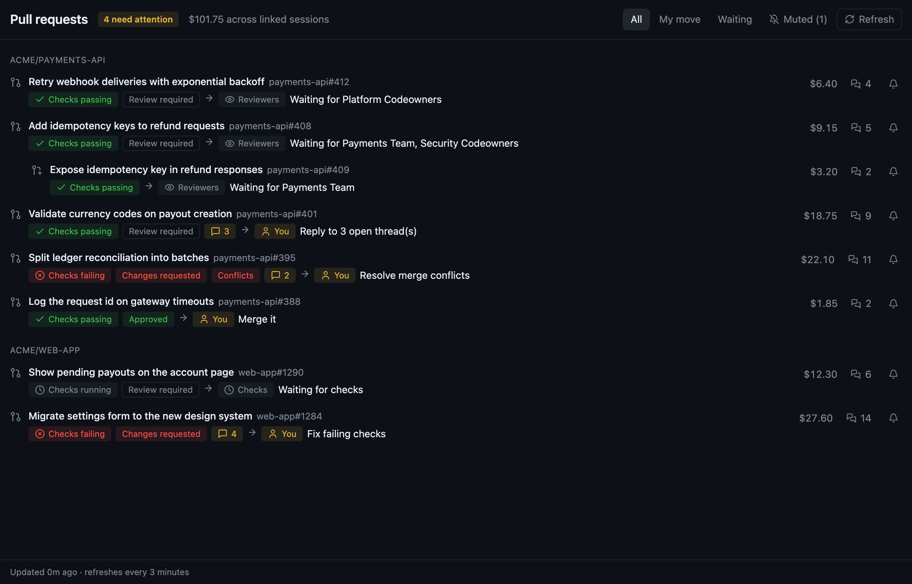
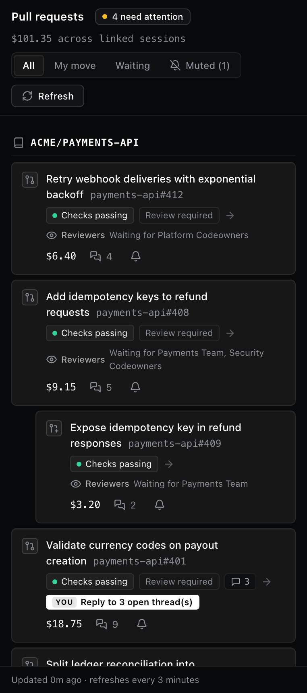
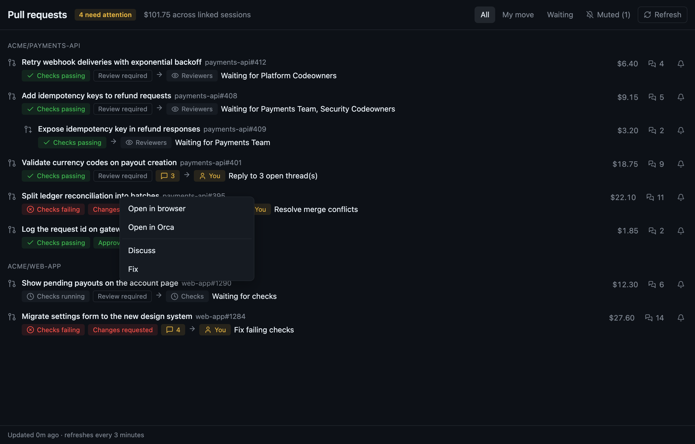
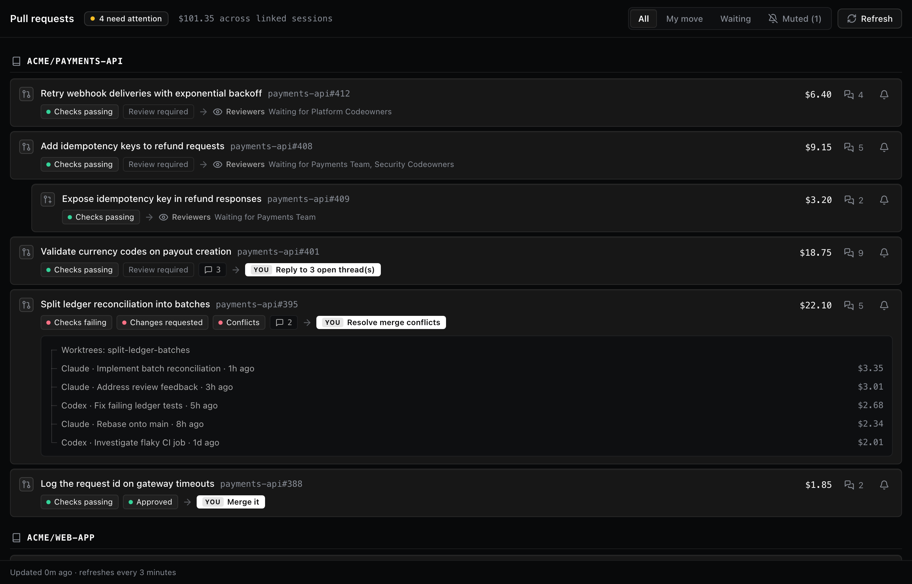

# Pull Requests Dashboard for Orca

See every open pull request you own in one place: what state it is in, who has to move next and what the AI sessions behind it cost. From there, one click gets an agent working on it.

<picture>
  <source media="(prefers-color-scheme: light)" srcset="docs/screenshots/dashboard-light.png">
  
</picture>

> Screenshots use made up repositories and pull requests.

## Features

- **Status at a glance:** checks, review decision, merge conflicts and unreplied review threads as chips.
- **Next move:** who has to act (you, reviewers or checks) and why, such as "Resolve merge conflicts" or "Waiting for Platform Codeowners".
- **Grouped and stacked:** pull requests are grouped by repository, and a pull request based on another open one is nested under it.
- **Session cost:** estimated from the token usage in the linked Claude Code and Codex transcripts, per pull request and in total.
- **Linked sessions:** the Orca worktrees on the pull request branch and the Claude Code and Codex sessions that worked on it.
- **Filters:** All, My move, Waiting and Muted. Muted pull requests are never counted or notified.
- **Search and repository filter:** find a pull request by title or number (`123` or `#123`), and show only the repositories you pick.
- **Collapsible repositories:** click a repository header to collapse or expand its pull requests. Every repository is expanded while searching.
- **Resume:** a pull request with a linked Orca workspace gets a Resume button that opens its most recently active one.
- **Status bar chip:** how many pull requests need you, always visible in Orca. Click it to open the sidebar panel.
- **Notifications:** a desktop notification when a pull request starts needing your attention.
- **Agent actions:** right click a pull request to start a Discuss or Fix workspace with the agent you pick in Settings.

## Sidebar panel

The same view lives in Orca's right sidebar, next to your work. On narrow widths each pull request wraps onto several lines.



## Right click actions



Clicking a pull request opens it in the system browser. Right clicking one gives you:

| Action | What it does |
| --- | --- |
| Open in browser | Opens the pull request in the system browser. |
| Open in Orca | Opens the pull request in an Orca browser tab. |
| Resume | Opens the most recently active Orca workspace linked to the pull request. Only shown when there is one. |
| Discuss | Creates a clean workspace in the pull request's Orca project, named after the pull request, with your agent. |
| Fix | Creates a workspace from the pull request head, named after the pull request, with your agent and a prompt asking it to check the pull request state and propose the fixes. The agent is told not to commit or push until you approve. |
| Copy PR link | Copies the pull request URL to the clipboard. |
| Mute notifications | Mutes the pull request, or unmutes it if it is already muted. |

## Linked sessions

Click the sessions count on a pull request to see its worktrees and agent sessions, with the agent and cost of each.



## Install

In Orca, open Settings, Plugins and install from this repository's URL, pinned to a release tag:

```
https://github.com/CarlosBaixoSI/orca-pr-dashboard#v1.3.0
```

Accept the requested access: a background worker, notifications, storage, settings, the sidebar panel and the status bar item. Leave out `#v1.3.0` to follow `master` instead.

### Releasing a new version

1. Bump `version` in `orca-plugin.json` and commit.
2. Tag the commit and push the tag: `git tag -a v1.2.0 -m v1.2.0 && git push origin v1.2.0`.
3. Reinstall in Orca from `…#v1.2.0`.

For local development, install from the cloned folder instead, and reinstall after each change, since Orca installs a hashed copy of the folder.

### Requirements

- Orca 1.4.248 or later.
- [`gh`](https://cli.github.com) signed in.
- Agent transcripts for session links and cost: Claude Code in `~/.claude/projects` and Codex in `~/.codex/sessions` (or `$CODEX_HOME/sessions`). Other agents' sessions are not counted.
- macOS for "Open in browser", which uses `open`.

## Settings

| Setting | What it does |
| --- | --- |
| Agent for Discuss and Fix | The agent the Discuss and Fix workspaces start with: Claude Code (default), Codex, GitHub Copilot, Cursor, Gemini or OpenCode. |

Before creating a workspace, Discuss and Fix check that the agent's command is installed, looking it up in your login shell like a new terminal does. When it is missing, the plugin shows an error and creates nothing.

## Commands

| Command | What it does |
| --- | --- |
| Open Pull Requests | Opens the dashboard in an Orca browser tab. |
| Show Pull Requests Panel | Opens the sidebar panel. The status bar chip runs this. |
| Refresh Pull Requests | Refreshes now instead of waiting for the next poll. |

## How it works

The background worker polls `gh` every 3 minutes, links each pull request to its worktrees and sessions, and works out the next move.

- **Browser tab:** the worker serves the page on `127.0.0.1:47213`. API calls require a per-install token and a local `Host` header.
- **Sidebar panel:** the same page talks to the worker through `orca.plugin.request`, since panel frames cannot reach the local server, and updates on every refresh.
- **Status bar:** the worker updates the chip with `statusBar.update` after every refresh and mute.
- **Discuss and Fix:** the worker finds the Orca project whose remote matches the pull request repository and runs `orca worktree create` with the agent from Settings.

### Agent sessions

Each supported agent has a module in `src/agents/` that reads its transcripts into the same shape: id, working folder, branches, pull request URLs, title, last activity and cost. A session links to a pull request when it recorded the pull request URL, or when it worked on the pull request branch inside one of the repository's worktrees. Only Claude Code records pull request URLs, so Codex sessions link by branch.

Session costs use the Claude and OpenAI prices in `src/pricing.mjs`. Codex logs do not report cache writes, so its cost leaves them out. A model missing from the table counts as $0. To support another agent, add a module to `src/agents/` and list it in `src/sessions.mjs`.

This relies on the worker being allowed to run `gh`, `git`, `orca` and a local server, which Orca does not guarantee.
